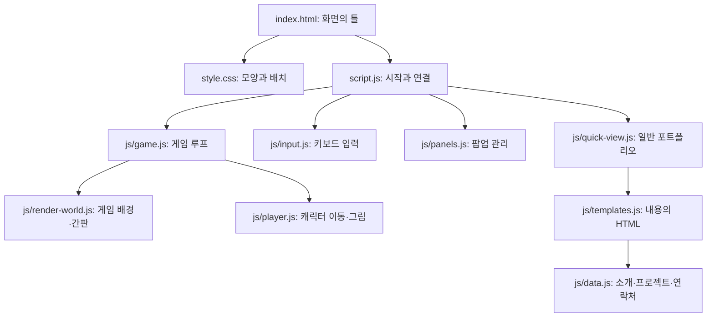

# 현재 포트폴리오 코드 설명

현재 열려 있는 index.html, style.css, script.js를 **한 줄씩** 설명한 안내입니다. 각 줄에 역할, 값을 바꿨을 때의 결과, 필수 여부를 적었습니다. 원본 파일은 그대로 두었습니다.

2026-10-08 기준: HTML 178줄 + CSS 1,283줄 + JavaScript 36줄 = **총 1,497줄**. 빈 줄·주석·닫는 태그·중괄호도 포함했습니다.

## 파일별 전체 설명

| 파일 | 읽을 설명서 | 담당하는 일 |
| --- | --- | --- |
| [index.html](../index.html) | [178줄 설명](index-lines.ko.md) | Canvas·버튼·팝업의 HTML 구조 |
| [style.css](../style.css) | [1,283줄 설명](style-lines.ko.md) | HTML 요소의 색·글꼴·크기·배치·반응형 화면 |
| [script.js](../script.js) | [36줄 설명](script-lines.ko.md) | 게임·입력·팝업 모듈을 연결하고 시작 |

원본에서 **Ctrl+G → 줄 번호**로 이동하고, 설명서에서 **Ctrl+Shift+V**로 Markdown 미리보기를 열면 편합니다. 코드 칸의 앞쪽 들여쓰기는 생략했습니다. 원본에 줄을 추가하거나 포맷하면 이 설명서의 번호와 달라질 수 있습니다.

## 파일들이 연결되는 방식



index.html 16줄이 style.css를 연결하고, 17줄이 script.js를 모듈로 실행합니다. script.js의 import 문이 js 폴더 안의 각 기능을 가져옵니다. 그러므로 script.js에 이동 속도 숫자가 없더라도 게임은 js/player.js를 통해 움직입니다.

화면은 Canvas 내부 그림과 HTML UI로 구성됩니다. 상단 정보, 팝업, 일반 포트폴리오는 CSS로 꾸밉니다. Canvas 내부의 캐릭터·배경·간판은 JavaScript의 그리기 명령으로 표시합니다.

## “반드시 필요한 코드”의 기준

웹페이지가 존재하기 위해 모든 기능이 필요한 것은 아닙니다. 이 설명서의 필수 표시는 **현재 구현을 유지할 때**를 기준으로 합니다.

| 표시 | 뜻 | 예 |
| --- | --- | --- |
| 동작 필수·게임 필수 | 지우면 현재 기능이 실행되지 않거나 오류가 날 수 있음 | Game 생성, game.input 연결, Canvas ID |
| 기능별 필수 | 해당 기능을 유지하려면 연결이 필요 | Quick View 초기화, 터치 입력 연결 |
| 선택 기능·연결 유지 | 기능 자체는 선택 가능하지만 참조를 함께 정리해야 제거 가능 | 터미널, 디버그 |
| 현재 배치·표시 | 화면 배치나 숨김 상태를 유지하는 규칙 | display, position, [hidden] |
| 접근성 권장·중요 | 키보드·스크린리더 사용을 돕는 정보와 표시 | aria-label, 포커스 outline, 건너뛰기 버튼 |
| 디자인·장식 | 값을 바꾸거나 다른 방식으로 구현할 수 있음 | 색, 테두리, 여백, 애니메이션 |
| 현재 미사용 | 현재 파일에서 실제로 참조하지 않음 | CSS --surface 변수 |
| 문법·구조 | 코드의 범위와 중첩을 표현 | CSS 중괄호, HTML 시작·끝 태그 |
| 선택(서식·주석) | 읽기 쉽게 만드는 것. 실행 기능은 없음 | 빈 줄, 개발자 주석 |

“디자인”이라도 삭제 결과는 있습니다. 예를 들어 --blue를 삭제하고 var(--blue) 참조를 남기면 해당 색 선언이 유효하지 않게 됩니다. 다른 색으로 바꾸거나 관련 참조까지 정리할 수 있다는 뜻입니다.

“선택 기능”도 한 줄 삭제로 끝나지 않습니다. 터미널을 제거하려면 script.js의 import, 초기화, 블록 분기, 단축키와 관련 HTML·월드 블록을 함께 판단해야 합니다. 살아 있는 코드가 삭제한 변수나 DOM을 사용하면 오류가 납니다.

HTML 시작·끝 태그 중 일부는 브라우저가 자동 보정할 수 있습니다. 그래도 현재 중첩을 명확히 유지하는 편이 좋습니다. CSS의 중괄호는 규칙 범위를 정합니다. JavaScript 세미콜론은 생략 가능한 위치도 있지만 30줄처럼 한 줄에 두 문장이 있는 경우 구분을 유지해야 합니다.

## 처음 보는 문법

| 표현 | 의미 |
| --- | --- |
| &lt;h1&gt;이름&lt;/h1&gt; | h1 제목 요소의 시작, 내용, 끝 |
| id="world" | 문서 안에서 요소를 식별하는 이름. JS의 #world 참조와 일치해야 함 |
| class="button primary" | button과 primary 두 스타일 이름을 붙임 |
| data-quick | JS가 Quick View 버튼이라고 알아보는 사용자 정의 표식 |
| data-close | JS가 팝업 닫기 버튼이라고 알아보는 표식 |
| aria-label | 스크린리더 등에 전달하는 설명. 화면 글자 자체를 바꾸지는 않음 |
| hidden | 요소를 숨기는 상태. JS가 상황에 따라 변경 |
| disabled | 버튼/입력창을 실제로 비활성화 |
| aria-disabled="true" | 비활성 상태를 접근성 도구에 알림. 클릭 차단은 JS나 disabled로 별도 처리 |
| .button | button 클래스 요소를 고르는 CSS 선택자 |
| #world | world ID 요소를 고르는 선택자 |
| .button.primary | 같은 요소가 두 클래스를 모두 가진 경우 |
| .panel-body h2 | panel-body 안의 모든 하위 h2 |
| .hud-brand &gt; span | hud-brand 바로 아래 자식 span |
| a, button | 링크와 버튼에 같은 규칙을 적용 |
| :hover / :focus-visible | 마우스가 올라간 상태 / 포커스 표시가 필요한 상태 |
| ::backdrop / :after | 팝업 뒤 배경 / CSS로 생성하는 장식 요소 |
| --blue / var(--blue) | CSS 변수 정의 / 그 변수 값 사용 |
| @media (...) | 조건이 맞는 화면·사용자 환경에서 규칙 적용 |
| import ... from ... | 다른 파일이 내보낸 함수·클래스를 가져옴 |
| const state = ... | state 변수를 선언하고 재대입을 금지. 객체 속성은 바꿀 수 있음 |
| new Game(...) | Game 클래스로 실제 게임 객체를 생성 |
| document.querySelector(...) | 선택자와 일치하는 첫 HTML 요소를 찾음. 없으면 null |
| () =&gt; game.interact() | 나중에 실행할 함수(콜백)를 만듦 |
| game.interact() | 지금 그 함수를 호출 |
| === | 값과 타입을 변환 없이 비교 |
| 조건 ? A : B | 조건이 참이면 A, 아니면 B |
| A &#124;&#124; B / !A | 둘 중 하나가 참 / 참·거짓을 뒤집음 |
| // 설명 | JavaScript 한 줄 주석 |

CSS에서 px는 CSS 픽셀, %는 보통 부모나 위치 기준 상자에 대한 비율, vw는 화면 너비의 1%, dvh는 브라우저 UI 변화를 반영한 화면 높이의 1%입니다. 1fr는 grid의 남는 공간을 나누는 비율입니다. 0.18s는 0.18초입니다.

## 원하는 변화를 만드는 위치

| 바꾸고 싶은 것 | 현재 위치 | 바꾸면 생기는 변화 |
| --- | --- | --- |
| 브라우저 탭 제목 | index.html 7줄 | 탭 제목 변경 |
| 검색 설명·공유 정보 | index.html 8–14줄 | 검색·공유 도구가 읽는 메타 정보 변경 |
| 화면 버튼 문구 | index.html 21–89줄의 해당 버튼 내용 | 버튼에 표시되는 문구 변경. data-* 동작 표식은 따로 유지 |
| HTML UI 기본 배경 | style.css 3줄 --bg | 해당 변수를 사용하는 body·Quick View 등의 배경 변경 |
| HTML UI 파란 강조색 | style.css 7줄 --blue | 해당 변수를 사용하는 제목·버튼 등의 강조색 변경 |
| HTML UI 기본 글꼴 | style.css 10–11줄 | 본문·고정폭 정보의 글꼴 후보 변경 |
| 상단 정보의 안쪽 여백 | style.css 181줄, 작은 화면 931·999·1273줄 | 화면 가장자리와 내용 사이 거리 변경 |
| Quick View 큰 이름의 크기 | style.css 748줄, 500px 이하에서는 1151줄 | 일반 포트폴리오의 이름 크기 변경 |
| 프로젝트 카드 열 개수 | style.css 801줄, 800px 이하에서는 989줄 | 카드 2열/1열 배치 변경 |
| 프로젝트 카드 안쪽 여백 | style.css 806줄, 500px 이하에서는 1177줄 | 카드 내용과 테두리 사이 거리 변경 |
| 정상 소개·프로젝트·기술·연락처 | [js/data.js](../js/data.js) | Quick View와 상세 패널의 실제 내용 변경 |
| JavaScript 미사용 대체 소개 | index.html 103–173줄 | JavaScript가 꺼졌을 때의 내용 변경 |
| 게임 시작 지점의 이름·간판 | [js/render-world.js](../js/render-world.js) 41–45줄 | Canvas 내부 이름·소개 변경 |
| 게임 내부 배경색 | js/render-world.js 12줄과 관련 그리기 명령 | Canvas 배경·도형의 색 변경 |
| 캐릭터 최대 이동 속도 | [js/player.js](../js/player.js) 11줄의 320 | 숫자가 클수록 빠른 목표 속도 |
| 캐릭터 가속·감속 | js/player.js 11줄의 2700·3400 | 숫자가 클수록 목표 속도에 더 빨리 접근 |
| 점프 시작 속도 | js/player.js 14줄의 -700 | 음수의 절댓값이 커지면 더 강하게 위로 점프 |
| 중력 | js/player.js 16줄의 1700 | 숫자가 클수록 아래 방향 속도가 더 빨리 증가 |
| 캐릭터 모양·색 | js/player.js 32–47줄 draw | 몸·머리·팔다리의 그림 변경. 충돌 크기는 5줄 별도 |
| 월드 크기·바닥 높이 | [js/world.js](../js/world.js) 1–3줄 | 이동 공간과 지면 위치 변경. 구역·블록 위치도 함께 판단 |
| 정보 블록 위치 | js/world.js의 createWorld 안 blocks | 블록이 월드의 어느 좌표에 놓이는지 변경 |
| 카메라 따라가기 | [js/camera.js](../js/camera.js) | 화면 확대·이동과 추적 방식 변경 |
| A/D·점프·E 키 | [js/input.js](../js/input.js) 1·18줄 | 실제 이동·점프·상호작용 입력 변경 |
| Q 단축키 | js/input.js 10줄 + script.js 21줄 + index.html 31줄 | 키 인식·실행 분기·화면 안내를 함께 변경 |
| PDF 이력서 | js/data.js 25줄 경로 + assets/resume/Junyoung_Oh_Resume.pdf | 실제 PDF가 확인되면 이력서 링크 활성화 |

게임의 이동·점프 값은 월드 좌표와 초를 기준으로 합니다. 화면에 보이는 픽셀 거리는 카메라 확대 비율에 따라 달라집니다. 이 표의 추가 JS 파일은 수정 위치를 안내하기 위해 확인했으며, 전체 줄별 설명의 범위는 현재 열린 세 파일입니다.

## 실제 수정 예제

### 1. 강조색 바꾸기

style.css 7줄의 값을 아래처럼 바꾸면 var(--blue)를 쓰는 HTML UI가 주황색으로 바뀝니다.

```css
--blue: #ff8a65;
```

Canvas 색은 js/render-world.js와 js/player.js에서 별도로 지정합니다. --surface는 현재 CSS에서 참조하지 않아 4줄의 값만 바꾸면 변화가 없습니다.

### 2. 일반 포트폴리오의 이름을 작게 만들기

style.css 748줄의 clamp(48px, 7.5vw, 96px)를 clamp(40px, 6vw, 80px)로 바꾸면 최소 40px, 권장 화면 너비의 6%, 최대 80px가 됩니다.

화면 너비가 500px 이하이면 1151줄의 font-size:49px가 별도로 적용됩니다. 그 화면에서도 이름을 작게 하려면 이 값도 조정합니다.

### 3. 카드 간격과 카드 안 여백 바꾸기

style.css 802줄의 gap:24px를 36px로 바꾸면 카드끼리의 간격이 커집니다. 806줄의 padding:28px를 40px로 바꾸면 각 카드 테두리 안쪽 공간이 커집니다. gap은 카드 사이, padding은 카드 안쪽입니다.

### 4. 캐릭터를 더 빠르게 움직이기

js/player.js 11줄의 input.axis*320을 input.axis*400으로 바꿉니다.

```js
this.vx=approach(this.vx,input.axis*400,(input.axis?2700:3400)*dt);
```

input.axis는 왼쪽 -1, 정지 0, 오른쪽 1입니다. 목표 속도가 -400/0/400이 되고, approach가 가속·감속하면서 그 값에 접근합니다. 2700과 3400은 그대로 두었으므로 목표 속도만 높아집니다.

### 5. Q 대신 P로 Quick View 열기

연결된 세 위치를 맞춥니다.

1. js/input.js 10줄의 KeyQ를 KeyP로 바꿔 입력을 인식합니다.
2. script.js 21줄의 KeyQ를 KeyP로 바꿔 Quick View 토글에 연결합니다.
3. index.html 31줄의 kbd 안 Q를 P로 바꿔 화면 안내를 맞춥니다.

화면의 Q 글자만 바꾸면 실제 키는 그대로입니다. script.js 분기만 바꾸면 Input이 새 키를 전달하지 않습니다.

### 6. 이름과 이메일 바꾸기

js/data.js의 profile.name과 contact.email이 정상 Quick View·상세 패널 내용의 원본입니다. profile.bio는 소개 문장, projects 배열은 프로젝트, skills는 기술 목록입니다.

게임 시작 간판 이름은 js/render-world.js 41줄에 따로 적혀 있습니다. index.html 34줄의 안내 이름과 noscript 대체 본문의 이름·연락처도 따로 있습니다. 메타 제목을 포함해 같은 정보의 각 표시 위치를 맞추면 됩니다.

## 값이 바뀌지 않는 것처럼 보일 때

선택한 요소, 현재 상태, 화면 조건을 함께 확인하세요. CSS는 같은 요소에 여러 규칙이 적용될 수 있고, 우선순위가 같으면 뒤쪽 규칙이 이깁니다. 이 파일은 기본 스타일 뒤에 1100px·800px·500px 이하 조정을 둡니다. 500px 화면에는 세 너비 조건이 모두 맞습니다.

CSS의 opacity:0은 시각적으로 투명하게 합니다. display:none은 배치 공간까지 없앱니다. pointer-events:none은 포인터 대상에서 제외합니다. 어느 설정이든 실제 게임 일시정지 여부는 state와 팝업 관리 JS가 결정합니다.

화면의 작은 키 안내나 CSS 애니메이션을 바꾸는 것과 게임 입력·물리 계산을 바꾸는 위치는 다릅니다. 위 수정 위치 표에서 해당 기능을 담당하는 파일을 찾아보면 됩니다.

현재 CSS 962줄의 #zone-banner.show~* 규칙은 뒤쪽 형제 전체에 pointer-events:auto를 적용합니다. 대부분 기본값과 같고, 디버그 상자의 pointer-events:none까지 덮어쓸 수 있습니다. 알림 표시 자체에는 필요한 규칙이 아닙니다. 이번에는 설명만 작성했습니다.
